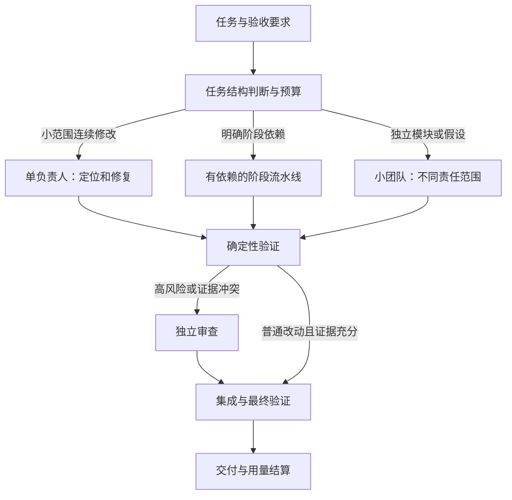

# OMC Agent Team 效率研究与开发建议

研究日期：2026-11-03。范围：论文、作者原始实验报告、官方工程文档；结合 OMC 当前代码和 [本地 token 审计](TOKEN-CACHE-AUDIT.zh-CN.md)。本文为研究与设计建议，没有修改运行中的 Team 或模型配置，没有执行付费对比实验。

## 1. 建议方向

把当前“主控 + 专业角色”升级为**按任务结构选择人数、按依赖分派、按证据结算、按预算调整的协作系统**。

默认小团队；简单任务单代理；只有真正独立的工作才并行。优先减少无效调用和重复上下文，再处理缓存亲和、模型升级及更复杂的调度。

这项建议来自研究综合与本地症状的匹配，不是任何单篇论文已经验证过的 OMC 实验结果。本地两批已结算子代理已有约 95% 输入缓存命中率，但共发生 1,022 个有用量的模型响应；WP2 有 162 次，最大单次输入 341,803 token。高缓存率与高重复处理量可以同时存在。

## 2. 文献与工程证据

### A. 团队结构与任务是否匹配

**[Towards a Science of Scaling Agent Systems，v3，2026-04-08](https://arxiv.org/abs/2512.08296v3)**

受控比较覆盖 260 种配置、6 个基准、5 类架构和3个模型家族。结果显示可分解任务可能获益，序列规划可能显著退化，工具密集任务存在协调开销。对 OMC 的启示是先判断可并行性，而非固定启动一套全角色流水线。研究任务与我们的仓库不同，不能搬用其性能变化比例作为收益承诺。采用 v3 结论，不沿用搜索摘要中旧版的精确阈值。

**[Multi-Agent Teams Hold Experts Back，ICML 2026](https://proceedings.mlr.press/v306/pappu26a.html)**

研究自由组织团队如何利用专家，发现团队可能倾向折中而削弱专家判断。它反对的是将无约束讨论当作可靠的专家整合机制，不证明所有有结构的团队都无效。OMC 应以可复现失败、接口约束和测试证据裁决争议；不要用模型投票数量代替正确性。

**[Why Do Multi-Agent LLM Systems Fail?，v3，2025-10-26](https://arxiv.org/abs/2503.13657v3)**

MAST 以 1,600 多条轨迹为数据基础，将 14 类失败分到系统设计、代理间不一致、验证三类。它是失败分析框架，不是一个能自动消除错误的组件。OMC 可据此给失败标记原因：任务不清、责任重叠、上下文缺失、过早结算、验证不足，再针对主要失败修复。

### B. 真正的 Agent Team 工程经验

**[Claude Code Agent Teams 官方文档，查询于 2026-11-03](https://code.claude.com/docs/en/agent-teams)**

官方将独立研究、模块开发和竞争性调试假设列为合适场景；同文件编辑、序列依赖任务更适合单会话。其共享任务列表、定向通信和完成通知可供借鉴。文档也明确团队增加 token 与协调开销。OMC 的初始并发建议应通过自己的实验决定，不能将其人数建议视作通用最优值；Claude 缓存 TTL 设置也不能照搬到 Go DeepSeek。

**[Building a C compiler with a team of parallel Claudes，2026-02-05](https://www.anthropic.com/research/building-c-compiler)**

16 个代理的案例强调任务认领、可靠测试、隔离工作区和简短日志；当大家被同一个内核问题阻塞时，增加人数不能解决瓶颈。作者采用已知正确的编译器作为参照，重新制造可独立验证的子问题。对 OMC 最有用的是“先制造可验证的独立工作”，而非复制人数或无限循环。它是单个高成本工程案例，没有证明最佳成本效率。

**[How we built our multi-agent research system，2025-06-13](https://www.anthropic.com/research/multi-agent-research-system)**

报告支持主控协调独立检索、子代理压缩结果、减少轮询，并同时披露额外 token 成本。研究检索任务比共享代码编辑更容易并行。文中的约 15 倍 token 比较基准是普通聊天，不能解释为相对单代理编码必然多 15 倍；其研究准确率增益也不能套到 OMC 修复任务。

### C. 上下文与工具调用成本

**[The Complexity Trap，v3，2025-10-27](https://arxiv.org/abs/2508.21433v3)**

SWE-agent / SWE-bench Verified 实验中，省略旧环境观察文本能使相对原始上下文的成本约减半，并与 LLM 摘要保持相近的修复表现；混合策略还有进一步收益。OMC 可先试低成本、可恢复的旧工具输出遮蔽。研究范围有限，其约 50% 不能作为采用 Go 高缓存率时的省钱预测；应计入遮蔽后的缓存重建成本。

**[Analyzing and Mitigating Cost-Inefficient Behaviors in Coding Agents，v3，2026-10-12，预印本/审稿中](https://arxiv.org/abs/2609.30725v3)**

作者分析了重复覆盖的检索、相似脚本生成、重复测试，发现手工设计的通用工作纪律有帮助；结构化检索在部分设置下反而使成本上升，最高报告 28.14%。因此 OMC 的检索索引、AST/LSP 接入都要计入索引、维护及检索轮次成本。它不是禁止结构化检索，而是提醒不要默认复杂工具一定更省。

**[Agentless: Demystifying LLM-based Software Engineering Agents，2024](https://arxiv.org/abs/2407.01489)**

以定位、修复、补丁验证三个阶段展示简单工作流的价值。适合作为 OMC 小修复任务的基线；它不是今天模型或复杂项目的最新性能榜单，不能把早期成本和成功率直接当作当前目标。

**[Google ADK：Architecting efficient context-aware multi-agent framework for production，2025-12-04](https://developers.googleblog.com/architecting-efficient-context-aware-multi-agent-framework-for-production/)**

关键工程思想是分开持久会话状态与每次模型调用的工作视图：通过明确的处理步骤筛选、压缩和注入信息，大材料保留为可取回的产物引用。OMC 可以采用这套分层方式而不必迁移到 ADK；这是官方设计实践，不是受控的 OMC 节省实验。

### D. KV 复用的适用层级

**[KVFlow，2025](https://arxiv.org/abs/2507.07400)** 与 **[KVCMAS，2026-09，预印本](https://arxiv.org/abs/2609.34060)** 分别研究工作流感知的缓存管理，以及共享同一模型时不同角色前缀导致的 KV 差异修正。

它们需要推理服务端的缓存管理或模型执行控制。当前 OMC 主要调用托管 API/外部 CLI，不能直接做 GPU KV 预取、低秩修正或跨供应商 KV 转移。近期可做的是稳定前缀、会话标识和路由，以及客户端可缓存的检索结果、构建产物与验证结果；后者必须标注失效条件。这两类缓存不应混为一谈。

## 3. 推荐的协作架构

主控负责目标、接口、依赖、预算与最终裁决。具体实现指定一个负责人；审查者提供证据和意见。主控若参与开发，只处理未被其他 worker 认领的范围，避免重复实现。

| 模式 | 适用任务 | OMC 建议初始行为 |
|---|---|---|
| single | 范围明确的小修复、单文件连续调试 | 一个实现负责人，直接运行相关验证；不强制先开 Explorer 再 Oracle |
| pipeline | 设计或数据契约必须先确定，后续实现依赖它 | 上游产出被验证后才启动依赖节点；中间复用简短交接 |
| team | 文件范围分离的模块、多个可检验假设、不同审查维度 | 先试主控 + 2 个 worker；独立审查按风险触发，不固定常驻 |

这些模式名和人数是拟议设计，不是已经存在的 OMC API。两个任务累计启动 9 个 child 不等于同时并发 9 个；优化要分别看总 child 数、同时活动数与关键路径。

### 3.1 派发前约定输入、输出和责任

每个工作包至少包含：

- `goal / acceptance`：目标与可观察的验收条件。
- `read_scope / write_scope`：相关路径和写入责任；共同接口先约定版本。
- `base_revision / working_tree_digest`：工作基线及未提交改动指纹，防止只看 commit 忽略本地变化。
- `facts / decisions / open_questions`：已验证事实、已决定约束与未决问题；每条重要事实有来源定位。
- `artifact_refs`：日志、详细轨迹、规范与测试结果的引用，按需展开。
- `budget / checkpoint / stop_conditions`：何时报告进度、何时升级或停止。

同一接口由一个节点负责，调用方依赖它；文件不重叠也不能自动推断语义独立。关键决策变化通过有版本的定向消息通知受影响节点，避免大家各读一份陈旧摘要。

### 3.2 上下文按需组成

完整日志继续保留用于追踪；每次请求只携带当前任务需要的视图：稳定角色说明、任务约束、少量已验证事实、最近相关工具结果和产物定位。

旧的长 read/grep/test 输出可在阶段边界变为结构化引用，保留命令、退出码、摘要和来源。失败堆栈、当前补丁、验收要求及未决问题优先保留。需要原文时可恢复，不将“模型摘要”当作原始证据。

避免每次调用滚动删除最前面的内容，否则会持续破坏前缀缓存。先试固定工作阶段和稳定检查点：一个阶段内保持历史前缀稳定；达到阶段边界再做一次视图变换，随后测量缓存恢复和后续累计成本。

本地结果缓存的 key 应包括工作区、相关内容指纹、工具版本与参数。测试缓存还需覆盖依赖、环境和产物；无法完整判断时视为 miss。具有写入或其他副作用的命令不能通过“缓存结果”省略执行。源码变化后的必要复读、验证不能误判为重复。

### 3.3 事件驱动与受控通信

原生使用完成/失败通知；外部 CLI 使用真实退出、超时与持久任务收据。主控等待时不通过模型反复询问“做完了吗”。监控由程序计数，不为更新状态新增模型调用。

默认只向与某决策相关的节点发送消息；内容限于新事实、接口变化、问题或完成证据。持久 inbox 消息应有序号，成功写入接收任务的上下文后才确认消费，允许重试且不重复注入。

当前 OMC 的外部任务运行中无法实时接收新指令；未实现控制协议前，必须明确标记 queued，下一次续派再消费。不能为了复刻“成员互聊”而声称消息已经影响当前运行。

### 3.4 根据进展调整预算与模型

初始建议延续上轮审计：Explorer 12–20 次模型响应、Fixer 30–50 次作为软检查点。预算还应同时看上下文、未缓存输入、输出、真实价格与已验证进展。数字是待校准的设计起点。

无进展检测可比较“代码/产物指纹、失败测试集合、未决问题、调用参数”等变化；同样命令反复执行、同样失败反复出现且没有新证据时，先给出检查点，再选择缩小范围、切换假设或升级模型。测试集合不变不代表一定没有价值，应结合补丁和诊断证据判断。

权限、路径、配额和工具故障先按故障类别处理，不能统统切换到更贵的模型。模型升级保留在同一任务中核算；切换可能改变前缀缓存，必须记录冷启动代价。单次响应 `maxTokens` 不是任务预算；降低思考档位也可能增加返工。

## 4. 如何同时提高准确率

1. **把验收提前。** 工作包派发前规定接口与关键回归；明确已知基线失败，避免把旧错误归给新补丁。
2. **确定性工具优先验证。** 类型检查、schema、相关回归和行为探针先跑，失败摘要再交给模型。小测试帮助快速迭代；最后的必要集成检查不能省略。
3. **独立审查按风险触发。** 权限、数据格式、并发、会话状态和公共接口优先审查；文案或局部低风险修改不强制新增审查代理。审查者先看任务、diff 和证据，减少被实现者结论锚定。
4. **以当前集成树结算。** worker 的测试通过不等于合并后通过；记录 worktree/commit/工作树指纹、测试命令、退出码和产物。最终验证匹配集成版本。
5. **允许 unknown / failed。** 模型说完成、进程 exit 0、最新消息存在，都不单独构成开发任务验收通过。无法确认的项保留明确状态。

独立审查仍可能漏报；模型一致同意也不等于正确。这里的“准确率”应定义为满足外部验收的任务成功率及回归情况，而非代理之间的一致率。

## 5. 对应现有 OMC 的开发落点

截至本轮读取代码，以下能力有基础，但需要连成闭环。

| 工作包 | 当前基础 | 拟议改动与验收 |
|---|---|---|
| E0：正确性与可观测性 | tokenUsage；task 收据；RoleResult 投影 | 先修 [剩余审计](REMAINING-AUDIT.zh-CN.md) 中的策略覆盖、无效 JSON 假成功和快照缺口；统一 native/external 终态、实际模型及用量。未知价格不报零成本。 |
| E1：上下文与重复工作 | `integration/handoff.js`；外部 bounded brief；宿主压缩/裁剪服务 | 给 native 也建立小工作包；增加可恢复工具产物与带失效条件的检索/验证缓存；先离线回放评估。旧提示和输出不得全量复制到所有成员。 |
| E2：预算与进展 | `src/config.js` 中有外部并发和超时；`integration/sessions.js` 存储会话引用 | 增加父任务/child 双层计数、软检查点、无进展检测与按类别升级；所有重试、取消和失败都计费归档。不能把已有外部上限误称为原生 Team 总预算。 |
| E3：真正的协作调度 | `integration/graph.js` 已有依赖和主动 claim；mailbox 有持久消息 | 在 role/provider 激活和结算处自动关联节点；持久 inbox 注入及确认；native cwd/worktree 绑定；没有明确 node 的既有调用要有兼容策略。避免存在未受控的第二条写入入口。 |
| E4：小团队与模型路由 | 角色模型配置、fleet、原生 send_message、external session resume | 在 E0–E3 稳定后加入 single/pipeline/team 选择、接口依赖、按风险审查、关键路径优先和动态人数；以实测成本/通过率选择模型。 |
| E5：缓存亲和 | 宿主已有 sessionId，Go 实际已大量命中 | 按实际 adapter 修复/验证动态会话 header，维持固定前缀和正确 session 身份；native 和外部 CLI 分别验证，不能仅凭 OMC 配置就承诺命中。 |

`integration/graph.js` 的注释明确它目前是契约存储而非调度器；`src/index.js` 的 reuse 分支目前返回任务和继续说明；`integration/role-result.js` 外部投影的 provider/model/usage 仍有 null。这些基础不应在新方案里被重复描述为已经完成的自动调度、自动续派或完整成本台账。

建议优先做 E0，然后 E1/E2，再接 E3 和 E4；E5 可独立验证，但无法替代前几项。近期收益最可控的是减少重复工作与提前停止无效循环。复杂 RAG、全员自由辩论、推理服务端 KV 共享保留为后续研究。

## 6. 如何证明真的更快、更省且更准

这轮没有足够数据承诺收益百分比。先制定小规模、可复现对比，再决定是否扩大测试预算。

### 对照方案

- A：当前 OMC 流程，固定起始模型、验收和可用工具。
- B：相同模型，加入小工作包、工具产物和上下文管理；先隔离这些变更的作用。
- C：在 B 基础上加入预算/进展控制和依赖调度。
- 单代理基线：在一部分任务上额外运行，检查 Agent Team 是否实际值得。

第一轮可选择 10–15 个历史任务，包含简单修复、跨文件接口、并发状态和独立模块；每种方案至少重复两次作为试验性观察，不能把该样本量当作统计充分。后续再扩大并报告置信区间。

所有方案使用同样的起始仓库、依赖、验收、最大任务预算和可比服务条件；随机化运行顺序，将冷缓存与热缓存分开。离线轨迹回放能检验计数、预算触发和视图大小，不能证明新流程的实时成功率。

### 核心指标

| 目标 | 应报告的指标 | 避免的误判 |
|---|---|---|
| token 降低 | 分开报告未缓存输入、缓存读/写、输出和模型调用数 | 只看总 token 或缓存命中率；把思考重复计入输出 |
| 成本降低 | 全部尝试的真实/可核算费用 ÷ 验收通过任务数；费用来源与价格版本 | 仅统计成功轨迹；漏掉主控、重试、审查、总结、失败和取消 |
| 速度提高 | 从接收到最终验收的墙钟时间，P50/P95；补充 TTFT、排队、工具和返工耗时 | 把各 lane 用时相加；只测第一个答案；忽略限流与合并等待 |
| 准确率提高 | 同一外部验收集的任务成功率、引入回归数、错误完成声明数 | 用模型自评、生成代码量、投票一致率代替正确性 |
| 协作有效 | 同范围重复工作、消息量、写冲突、返工轮次、关键路径等待 | 只统计同时启动了多少代理 |

所有失败与超时留在成功率分母，并单列预算截断率。质量使用固定的外部行为验收和必要的独立复核；模型生成的新测试可以补充，但不能作为唯一正确性标准。

试验性工程目标可以先设为“在成功率不下降的条件下争取降低成本和 P50 完成时间”，不预先宣称一定节省 30% 或提速两倍。小样本只能帮助选择下一轮实验，不能证明质量无损。若质量不确定，保留原路径作为回退。

## 7. 最值得先做的三个改动

1. **共享事实与产物引用，加上可验证的失效条件。** 针对当前反复读仓库与长工具回显，减少每个 child 的重复勘探。
2. **程序化预算与进展检查点。** 把 88/107/162 次调用的长工作及时拆分或升级，不靠主控反复询问进度。
3. **依赖驱动的小团队 + 确定性验收。** 接通现有 graph、mailbox、RoleResult 与真正的执行生命周期，保证速度收益能够转成最终可验收的交付。

研究最直接支持的是这些可观测、可验证的机制。实际收益仍需 OMC 在相同任务、质量要求和预算条件下测量。
