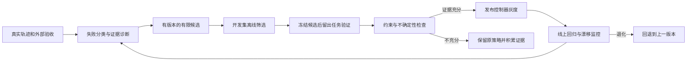

# OMC 会话策略监控、反馈与自主优化

日期：2026-11-03。目标：比较“原会话续接/压缩、新会话交接、自适应选择”三种策略，以验收、成本和最终完成时间驱动改进。

本轮已实现**离线实验分配与评估工具**；运行时自动采集、自动切换会话、候选生成器、灰度发布与自动回退仍需接入。没有使用真实任务进行三策略对照，没有修改正在运行的模型或权限。

## 1. 文献与设计依据

| 来源 | 可采用的结论 | 应保留的边界 |
|---|---|---|
| [Anthropic：Demystifying evals for AI agents，2026-01](https://www.anthropic.com/research/demystifying-evals-for-ai-agents) | 分开任务、试验轨迹、环境最终结果；结合代码、模型和人工评价；同时维护能力集与回归集 | 模型评分需校准，代理自报完成不是环境结果；“至少成功一次”和“多次始终成功”是不同问题 |
| [AI Agents That Matter，2024 / TMLR 2025](https://arxiv.org/abs/2407.01502) | 联合评估成本和准确性，重视留出任务与可复现性 | 只优化成功率可能奖励昂贵复杂系统；反复调同一测试集会过拟合 |
| [GEPA，2026 修订，ICLR 2026](https://arxiv.org/abs/2507.19457v2) | 用轨迹和自然语言反馈生成候选提示，保留互有优势的候选并重新评估 | 提示优化不等于模型权重训练；论文任务和预算不同，不能承诺在 OMC 重现收益 |
| [Reflexion，NeurIPS 2023](https://arxiv.org/abs/2303.11366) | 将失败反馈转成跨尝试可使用的经验记忆 | 反思只是待验证的解释；错误反思可能被持续复用，必须有来源、适用范围与失效条件 |
| [Agent Lightning，2025](https://arxiv.org/abs/2508.03680) | 将执行、可观测记录与学习过程解耦，支持细粒度归因 | 真正的强化学习涉及训练与模型控制；当前托管 API 插件应先优化编排/提示策略 |
| [OpenTelemetry GenAI 官方仓库](https://github.com/open-telemetry/semantic-conventions-genai) | 对齐调用、工具与代理轨迹的层级表示，便于后续导出 | 官方旧页面已迁移；接入时固定规范版本。当前工具未安装 OTel SDK，也未向外部上传轨迹 |
| [The Complexity Trap，2025](https://arxiv.org/abs/2508.21433v3) | 将旧工具输出遮蔽/摘要作为独立可测策略 | 研究不证明固定会话永远更好；压缩可能打破缓存或丢失关键信息 |
| [Anthropic：Harness design for long-running apps，2026-03](https://www.anthropic.com/research/harness-design-long-running-apps) | 某些模型适合重置交接，另一些可以持续运行并压缩 | 模型依赖显著，不能跨模型使用同一结论；工程案例并非完整受控比较 |

本方案的工程判断是：**先让反馈可信，再让策略有边界地自动更新。固定代理数量、提高续接率或缩短日志都不是最终目标。**

## 2. 三个实验组如何定义

| 策略 ID | 必须固定的行为 | 需要记录的代价 |
|---|---|---|
| `reuse_compact` | 同模块同负责人优先续接同一 child；达到预先规定阈值才缩减上下文 | 历史携带、摘要调用、缓存重建、错误假设延续 |
| `fresh_handoff` | 每次后续工作使用新 child，携带统一的已验证事实与产物交接 | 冷启动、重复定位、交接遗漏 |
| `adaptive` | 用冻结版本的规则，根据相关性、上下文和进展选择续接、缩减或重开 | 决策、额外检索、规则误判；不能在测试中途偷偷更新规则 |

“新增代理”不等于没有交接。B 组必须有合理、完整的结构化交接，否则只是将优良实现与劣质实现比较。三组使用共同任务信息、验收和基础角色说明；只让会话管理机制不同。

第一轮保持同一模型、工具、并发上限和总任务预算。模型路由、工作包粒度、并发人数后续分别做消融，避免一次改变多个机制却无法解释收益。

### 实验单位是完整父任务

一次 trial 从接收需求到最终验收或截止，包含全部 child、重试、压缩、审查、验证及恢复。多阶段、会话续接频繁的任务最适合揭示差异；完全独立的一次性小任务作为对照保留。

按“任务 × 重复编号”建立配对区组，在每个区组随机化三策略运行顺序。每次从相同工作树/依赖/验收起点运行，隔离写入与会话状态。不得把前一组的答案、反思或修改送到下一组。

缓存冷/热分开实验；托管服务端缓存无法强制清空时如实记录，不能仅靠新 session ID 宣称冷缓存。避免同时跑三组造成限流竞争；真实等待和服务端异常仍记录，通过随机顺序/重复控制时间偏差。

需要比较的不是“20 个 child 对 5 个 child”，而是“同一任务在相同交付要求下，每组实际消耗与验收结果”。

## 3. 监控需要记录哪些信息

建议链路：`experiment → trial(parent task) → decision → task/node → attempt → model/tool/compaction → acceptance`。每个节点有稳定 ID、父 ID、版本、开始/结束及状态。统计幂等使用事件来源与序号，沿用现有 usage-ledger 的原则。

### 三类记录

1. **分配记录**：在运行前冻结任务、版本、策略、预算、模型/工具/环境指纹、随机种子与顺序；所有已分配 trial 都进入分母。
2. **决策记录**：当时可选动作、选择理由、策略版本、相关性判断、上下文大小、已有会话健康度、近期进展、实际执行动作。记录结构化理由，不采集模型内部推理链。
3. **结果记录**：真实执行终态、独立验收、关键回归、错误完成声明、全链路四桶 token/费用、调用次数、最终墙钟时间、人工帮助和证据引用。

记录选择时可见的特征，不把事后失败结论当作当时可用信息。策略要求续接但实际上新建时保留 `strategyApplied:false`；仍纳入按原分配组的描述统计，但阻止策略晋升建议。

### 与当前模块的接线

| 当前基础 | 应提供的数据 | 仍需做的接线 |
|---|---|---|
| `integration/usage-ledger.js` | 四桶用量、实际路由、attempt、来源事件与费用覆盖 | 按 trial 归集主控、全部子任务和辅助请求，证明无漏记/重复 |
| `integration/execution-events.js` | 执行与 acceptance 分开、重试/取消状态 | 关联 experiment/trial；截止时为缺失结果生成显式记录 |
| `integration/managed-execution.js` / graph | 责任、依赖、激活与结算 | 分配策略与真实动作一致性；失败和崩溃纳入结果 |
| `integration/progress.js` / budget | 无进展信号、检查点和调整 | 决策快照；动作之后记录是否解决原问题 |
| WorkPacket / Artifact | 来源、内容指纹、交接与取回 | 统计交接后重复读取与失效事实，区分必要复读与浪费 |
| 新 `integration/strategy-eval.js` | 冻结分配、三组汇总、不确定性与晋升建议 | 目前只读导出的记录；未装入实时运行链路 |

不要直接把 ledger 的 `entries` 当作所有请求数，或把部分已知费用当成完整总价；以真实发送尝试与覆盖状态为准。collector 需要逐路径对账。当前离线工具验证声明的一致性，不能证明 collector 或 grader 没有撒谎或漏记。

## 4. 指标：质量约束在前，成本和速度在后

| 层级 | 主要指标 | 用途 |
|---|---|---|
| 正确性 | 外部验收成功率、关键回归、错误完成声明 | 禁止通过提前放弃、删测试或自评获取“效率提升” |
| 可靠性 | 每任务所有重复都通过的比例；单次通过分布 | 看是否稳定，而非只挑某次成功。当前工具的可靠性指标不是 pass^k 的无偏估计 |
| 成本 | 全部运行费用 + 策略优化成本，再除以通过任务数 | 包括失败、压缩、模型审查和优化器；通过数为零时未定义 |
| 速度 | 到最终验收/截止的 P50/P95，全体结果与失败率并列 | 不能只看首答、把 lane 用时相加，或忽略被提前停止的任务 |
| 输入与循环 | 未缓存/缓存读/写/输出、请求尝试数、工具次数 | 找原因，不将缓存率/总 token 单独当目标 |
| 协作诊断 | 续接机会、续接次数、重开原因、重复勘探、冲突和返工 | 判断什么任务适合哪种策略；不是越少 child 越好 |
| 外部帮助 | 人工介入次数/耗时、模型升级与预算增量 | 防止更高人工投入被隐藏成代理能力增长 |

策略评分采用约束与多目标比较：先过验收/回归，再看成本和速度；保留不同任务类型上的优势策略。不要把 token、耗时、成功率随意加成一个可被钻空子的总分。

### 统计与小样本

同一任务的多次运行相关，按任务聚类/配对比较。离线工具对费用/完成时间使用任务级重采样，每次保留该任务全部重复；未知或零成功导致比值未定义时，不丢弃这些重采样结果来制造确定性。

质量采用任务级“全部重复通过”的保守 Wilson 差界，避免 bootstrap 在小样本全通过时给出零不确定性。它是正态近似区间，不是配对精确检验，也不能证明对任意生产任务泛化；真实推广需更有代表性的样本和方法复核。

工具默认最低 30 个不同任务、每任务至少 2 次重复，只是最低检查，不是统计充分性保证。质量默认允许损失为 0，少量全通过也可能无法证明非劣；此时输出 insufficient-evidence。不要为了晋升而事后放宽阈值。

只对预先指定的一对策略给出晋升建议，其余对比作探索报告，降低“挑最好结果”风险。不以每天重复查看同一个固定样本的置信区间作为连续检验；需要在线序贯判断时，应另行设计有效的序贯界限与停止规则。

## 5. 反馈如何转成自主改进



### 候选可以改什么

先限定为会话续接相关性规则、上下文阈值、摘要模板、产物取回方式和无进展处理。候选记录 parentVersion、变更差异、适用任务、失败样本引用、预期机制、优化费用、回退版本；一次尽量只改一类机制。

权限、可写范围、付费授权、验收标准和总预算不由候选自行放宽。优化器也不能读取留出集答案或反复修改测试迎合自己的输出。重要新经验需要外部结果支持；“代理反思说这样更好”只生成假设，不直接进入永久规则。

开发/验证/留出按项目或问题族隔离，避免同一个问题的不同措辞同时出现在开发和测试中。留出结果一旦用于调参，就成为已使用的验证信息；下一次确认需要新的留出任务。继续维护稳定回归集，防止新候选遗忘已有能力。

### 分层的自主程度

- L0：采集、统计、异常提示，由程序完成，不消耗额外模型调用。
- L1：对选定失败轨迹生成有证据的候选，设独立优化预算；可借鉴 GEPA/Reflexion，记录反思成本。
- L2：自动在开发/验证集淘汰差候选，冻结版本后运行一次留出评估。
- L3：发布控制器按预先配置规则灰度、监控并回退。不是让执行中的代理自己改自己的评价标准。

本轮工具实现 L0 的离线比较及 L2 的部分证据检查；没有候选生成、在线分配、模型训练、真实 grader、自动灰度或回退执行器。`candidate-for-review` 代表可进入下一层发布检查，不等于已更新策略；这个检查可以由后续发布控制器执行，不必把每一次策略更新都变成人工确认。

灰度时按完整父任务稳定分配版本，运行中不热切策略；有前一版本可一键/自动恢复。监控成功率、关键回归、错误完成声明、未知覆盖与预算超支。观察性线上相关关系用于发现问题；因果收益仍主要由受控分配证明。

## 6. 已实现的工具及使用方法

新增模块：[strategy-eval.js](../integration/strategy-eval.js)。命令行：[strategy-eval.mjs](../scripts/strategy-eval.mjs)。无新依赖、无网络、无模型调用，不覆盖已有输出，不写运行配置。

先使用 [示例规格](examples/strategy-eval.spec.json) 生成冻结分配：

```powershell
node scripts/strategy-eval.mjs plan docs/examples/strategy-eval.spec.json .ops/strategy-manifest.json
```

示例明确为 synthetic/development。生成任务安排不代表执行了任务。真实实验需要填写版本/指纹、合理任务、预算和独立验收，并由尚待接入的运行器执行。

运行结果文件是 JSON 数组；每个 trial 一行记录含全部 attempts 的汇总，不为每次重试重复写 trial。示意：

```json
{
  "schemaVersion": 1,
  "experimentDigest": "从 manifest.digest 复制",
  "conditionsDigest": "从 manifest.conditionsDigest 复制",
  "dataKind": "synthetic",
  "trialId": "从 manifest.assignments 复制",
  "policyVersion": "对应策略的冻结版本",
  "strategyApplied": true,
  "execution": "completed",
  "acceptance": "passed",
  "evidenceKind": "external-tests",
  "evidenceRef": "验收产物引用",
  "criticalRegression": false,
  "falseCompletion": false,
  "collectionCoverage": "complete",
  "calls": 20,
  "attempts": 2,
  "humanInterventions": 0,
  "elapsedMs": 180000,
  "costUsd": 0.1,
  "costBasis": "estimated",
  "costVersion": "实际价格来源版本",
  "usage": {
    "uncachedInputTokens": 10000,
    "cacheReadTokens": 50000,
    "cacheWriteTokens": null,
    "outputTokens": 2000
  }
}
```

`costUsd:null` 配 `costBasis:"unknown"`；未报告 token 桶用 null。costBasis 区分 billed/estimated，主比较不混用不同来源版本。`optimizerCostUsd` 在规格中逐策略显式填写：确实没有费用才为 0，不知道则 null。失败验收也必须有证据；timeout/failed/cancelled 可以使用 `evidenceKind:"runtime-terminal"` 和真实终态收据证明执行失败，不能用它证明 completed 的行为验收或成功。

结果汇总：

```powershell
node scripts/strategy-eval.mjs report .ops/strategy-manifest.json .ops/strategy-runs.json .ops/strategy-report.json
node test/integration/strategy-eval.test.mjs
```

输出包含三组样本数、缺失/等待数、验收成功、任务可靠性、四桶 token、全量成本与通过任务费用、耗时分布、任务级比较和 review 原因。

review 可能为 blocked、insufficient-evidence、rejected 或 candidate-for-review；始终 `automaticActivation:false`。模拟或回放数据、未分级任务、忽略分配、缺成本、增加人工帮助、仅模型评分等条件阻止晋升建议。关键回归或错误完成声明直接拒绝。

## 7. 与 alpha.2 计划的关系

当前工作区已经出现 WP02–WP06 等实现模块；“文件存在”不等于它们已全部通过原生/外部/Desktop 验收。本轮不重写其他正在推进的运行时代码或提前标记原计划全部完成。

新增反馈子计划 F00–F05 见 [feedback-evolution.backlog.json](plans/feedback-evolution.backlog.json)：本轮先交付 F00 数据/实验协议、F01 离线工具；后续接 collector/运行器/真实 grader，再接有限候选和发布控制器。

第一轮真实试验可从 10–15 个任务、每组每任务两次开始用于发现大问题，但必须列出全部运行及优化费用，不据此宣称质量等效或自动晋升。确认目标仍不足时扩充不同任务族，不单纯堆同一个任务的重复次数。

最先值得转成回归任务的真实问题包括：项目限制被覆盖、无效 JSON 假成功、错误模型元数据、续接丢失约束、摘要遗漏接口决定、相同代码重复侦察、取消后误报完成，以及不同 writer 冲突。
